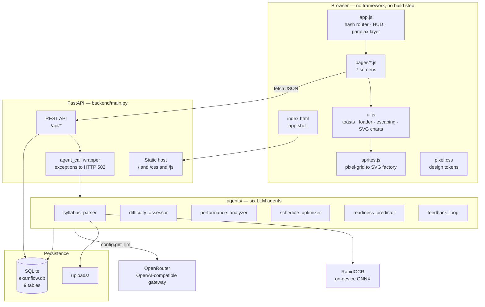
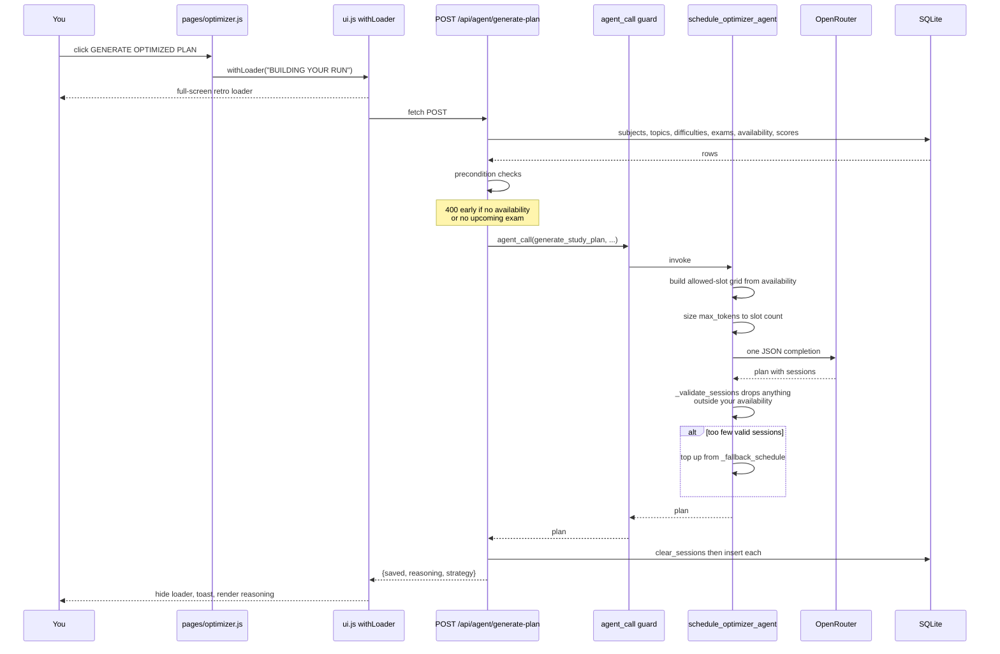
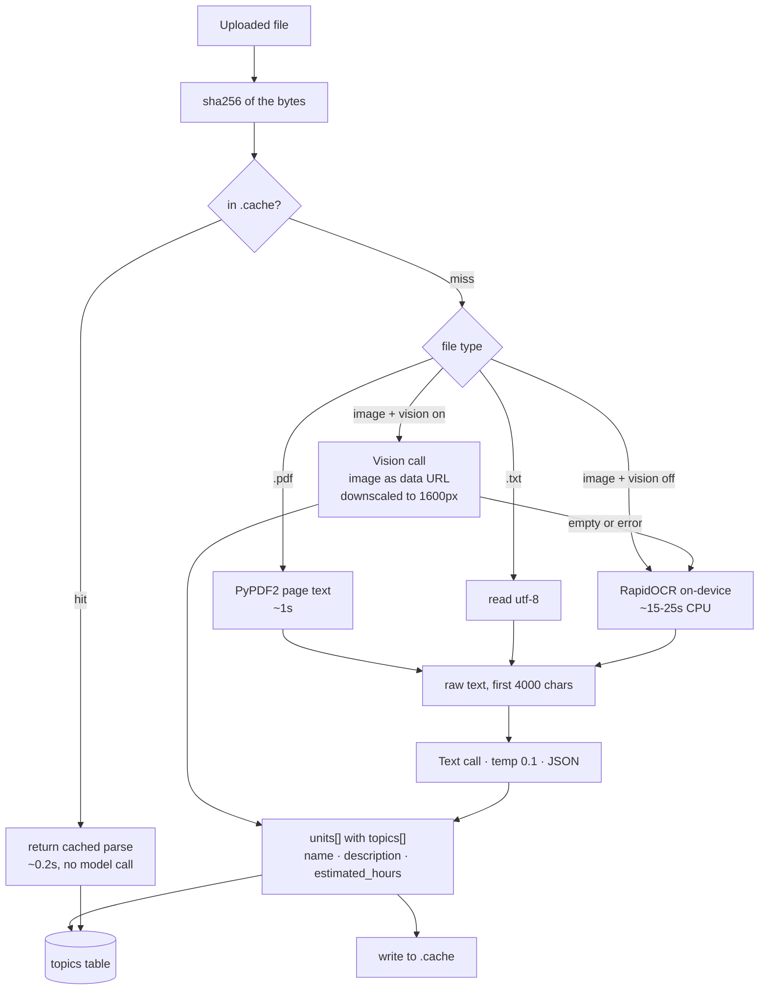
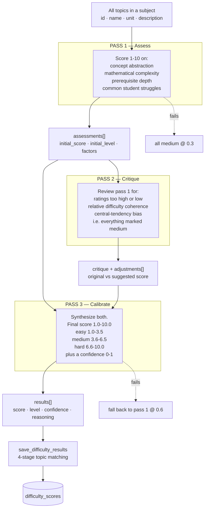
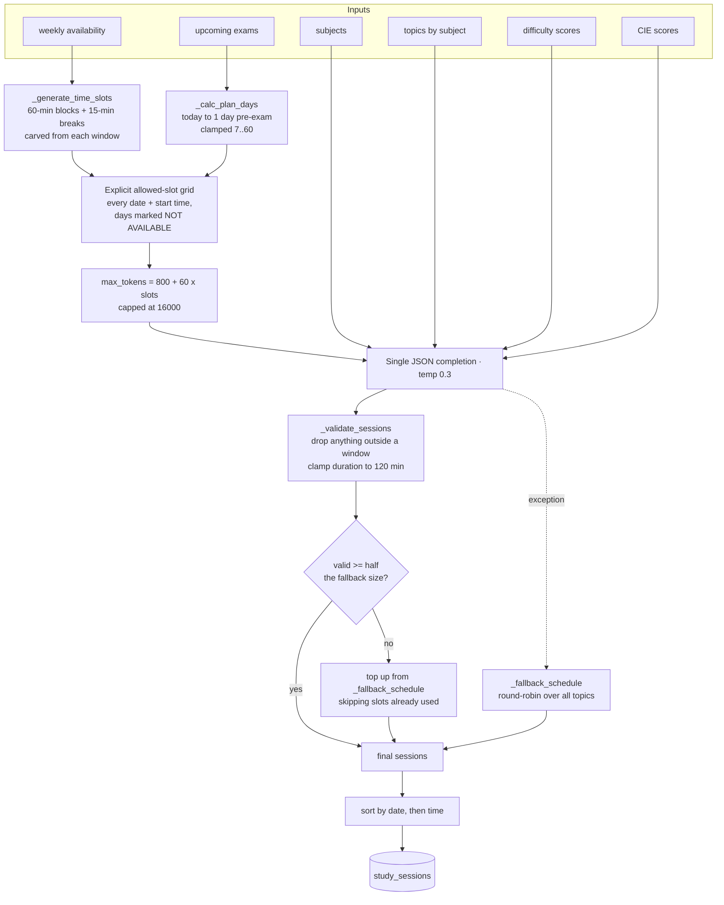
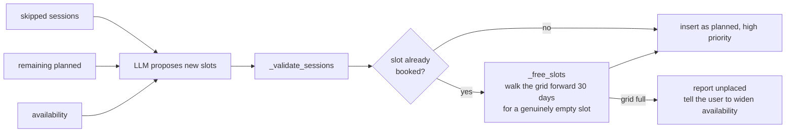
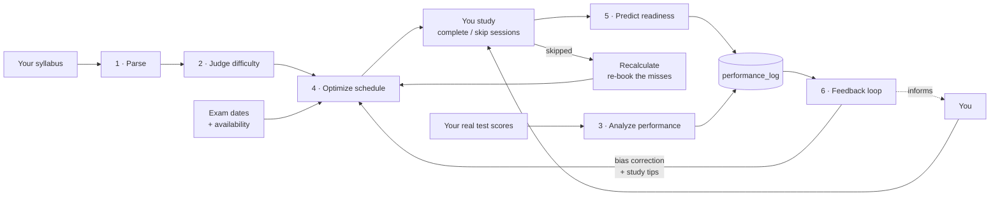
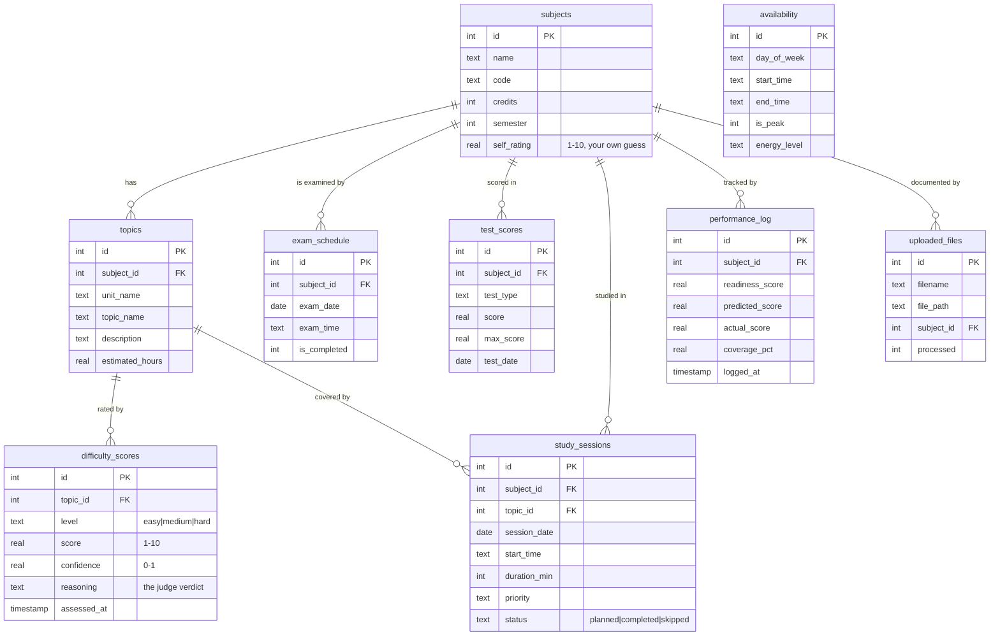

# ExamFlow AI

**An AI-powered exam timetable optimizer.** Point it at your syllabus, tell it when your
exams are and when you're actually free, and six LLM agents turn that into a study plan
that re-plans itself as your real scores come in.

FastAPI backend · SQLite · OpenRouter · a hand-built 8-bit arcade frontend with no
framework and no build step.

---

## Contents

- [Quick start](#quick-start)
- [Configuration](#configuration)
- [System architecture](#system-architecture)
- [Request lifecycle](#request-lifecycle)
- [The six agents](#the-six-agents)
  - [1. Syllabus Parser](#1-syllabus-parser)
  - [2. Difficulty Assessor](#2-difficulty-assessor--llm-as-judge)
  - [3. Performance Analyzer](#3-performance-analyzer)
  - [4. Schedule Optimizer](#4-schedule-optimizer)
  - [5. Readiness Predictor](#5-readiness-predictor)
  - [6. Feedback Loop](#6-feedback-loop)
- [The closed loop](#the-closed-loop)
- [Data model](#data-model)
- [API reference](#api-reference)
- [Frontend architecture](#frontend-architecture)
- [Project layout](#project-layout)
- [Extending it](#extending-it)
- [Performance and cost](#performance-and-cost)
- [Troubleshooting](#troubleshooting)
- [Known limitations](#known-limitations)

---

## Quick start

```bash
pip install -r requirements.txt
cp .env.example .env          # paste your OpenRouter key into it
python run.py                 # -> http://127.0.0.1:8000
```

On Windows, if `python` resolves to the broken `C:\Windows\System32\python` stub, use the
launcher or the full interpreter path:

```powershell
py -3 run.py
```

The app works without an API key — you can add subjects, set exams, build the availability
grid and browse everything. Only the six AI buttons need the key, and they tell you when
it's missing rather than failing silently.

**First run, in order:** Setup → add subjects · Setup → upload a syllabus · Syllabus → run
the difficulty assessment · Schedule → set exam dates and availability · Optimizer →
generate the plan.

Or hit **LOAD DEMO SAVE** on the landing page to seed five subjects with topics and
difficulty scores.

### Before a live demo

```bash
python prewarm.py     # parse every file in uploads/ into the cache
```

Uploads of those files then return in ~0.2s instead of 6–18s, and they can't fail on
stage because of a flaky network. `python prewarm.py --clear` empties the cache.

Two other things worth doing beforehand: narrow your **availability** windows (a 06:00–20:00
grid produces 11 sessions a day and a 50s plan generation; 3–4 hours a day is both
realistic and much faster), and run the difficulty assessment once so the radar has data.

---

## Configuration

Everything lives in `.env` (gitignored). `config.py` loads it via `python-dotenv` before
anything reads `os.environ`.

| Variable | Default | Purpose |
| --- | --- | --- |
| `OPENROUTER_API_KEY` | — | Required for the AI agents. Everything else works without it. |
| `EXAMFLOW_MODEL` | `openai/gpt-4o-mini` | Any OpenRouter model id. Must support `response_format: json_object`. |
| `OPENROUTER_BASE_URL` | `https://openrouter.ai/api/v1` | Swap for a different OpenAI-compatible gateway. |
| `EXAMFLOW_MAX_OUTPUT_TOKENS` | `16000` | Output ceiling for the schedule optimizer. Must not exceed your model's limit. |
| `EXAMFLOW_VISION` | `1` | Send images straight to the multimodal model. `0` forces the offline RapidOCR path (~5x slower). |
| `EXAMFLOW_CACHE` | `1` | Cache parsed documents by content hash in `.cache/`. |
| `OPENROUTER_APP_NAME` / `OPENROUTER_SITE_URL` | `ExamFlow AI` / localhost | Attribution headers shown on your OpenRouter dashboard. |
| `EXAMFLOW_HOST` / `EXAMFLOW_PORT` | `127.0.0.1` / `8000` | Server bind address. |
| `EXAMFLOW_OPEN` | `1` | Set `0` to stop it opening a browser on start. |

### Choosing a model

The agents emit deeply nested JSON, so the model must be reliable under
`response_format: json_object`. Verified options, cheapest first:

| Model | Prompt / Completion per 1M | Notes |
| --- | --- | --- |
| `mistralai/mistral-small-3.2-24b-instruct` | $0.075 / $0.20 | Cheapest that still holds the schema. |
| `meta-llama/llama-3.3-70b-instruct` | $0.10 / $0.32 | The prompts were originally authored against this. |
| **`openai/gpt-4o-mini`** *(default)* | **$0.15 / $0.60** | Best reliability-per-rupee on the 3-pass judge. |
| `google/gemini-2.5-flash` | $0.30 / $2.50 | Strongest, but output tokens get expensive on the optimizer. |

---

## System architecture



**The load-bearing idea:** `agents/` and `db/` know nothing about HTTP, and the frontend
knows nothing about the LLM. `backend/main.py` is the only place the two meet, which is
why the agents were reusable unchanged when the UI was rewritten from Streamlit.

---

## Request lifecycle

Every AI action follows the same path. Using "generate a study plan" as the example:



Two defensive layers worth knowing about:

- **`agent_call`** ([backend/main.py](backend/main.py)) wraps every agent invocation. Any
  exception becomes a clean HTTP 502 with the message, and if `OPENROUTER_API_KEY` is
  unset it prefixes that fact so the UI can say something useful.
- **Every agent has a deterministic fallback.** A model outage degrades a feature to
  arithmetic; it never breaks the page.

---

## The six agents

All six live in `agents/`, are plain functions, and get their model from
`config.get_llm(temperature, max_tokens, json_mode)`. None of them import FastAPI.

| # | Agent | Pattern | LLM calls | Fallback when the model fails |
| --- | --- | --- | --- | --- |
| 1 | Syllabus Parser | Chain-of-thought extraction | 1 | Empty unit list + error in `reasoning` |
| 2 | Difficulty Assessor | **LLM-as-Judge, 3 passes** | 3 | Pass-1 results, else all `medium` @ 0.3 confidence |
| 3 | Performance Analyzer | Comparative analysis | 1 | Threshold arithmetic on score percentages |
| 4 | Schedule Optimizer | Constraint-aware planning | 1 | Round-robin slot filler |
| 5 | Readiness Predictor | Chain-of-thought scoring | 1 per subject | Weighted formula with hard-topic penalty |
| 6 | Feedback Loop | Meta-analysis | 2 | Mean absolute error per subject |

---

### 1. Syllabus Parser

`agents/syllabus_parser_agent.py` — turns a document into structured units and topics.



Two prompts share the extraction step:

- **`parse_syllabus`** → `{subject_name, reasoning, units[{unit_name, topics[{topic_name, description, estimated_hours}]}]}`
- **`parse_question_paper`** → `{important_topics[{topic, frequency, marks_weight}]}` — used
  to spot which topics actually get examined.

The prompt asks the model to reason about structure *before* emitting units, and that
reasoning is surfaced in the UI rather than thrown away.

**Images go to the vision model, not to OCR.** Local RapidOCR costs 13–25s of CPU on even
a 470×821 screenshot, and its output is rough (`Intemet`, `CLA Tria`). Sending the image
directly to the multimodal model is one network call instead — measurably faster *and*
more accurate, because the model sees the table layout rather than a flattened line dump.

| Route | 470×821 screenshot | Quality |
| --- | --- | --- |
| RapidOCR then text parse | ~40–58s | Typos the parser has to guess at |
| **Vision call** *(default)* | **6–18s** | Reads `CIA Triad` correctly |
| **Cache hit** | **0.2s** | Identical |

RapidOCR is kept as the fallback: it runs when `EXAMFLOW_VISION=0`, when the configured
model can't read images, or when the vision call returns nothing. That keeps a fully
offline path available — no image ever leaves the machine on that route.

**Parse cache.** Every upload is hashed (sha256 of the bytes) and its parsed result stored
in `.cache/`. Re-uploading the same document skips OCR *and* the model entirely. Run
`python prewarm.py` before a demo to warm every file in `uploads/` up front.

---

### 2. Difficulty Assessor — LLM-as-Judge

`agents/difficulty_assessor_agent.py` — the most interesting agent in the project. Rather
than trusting one scoring pass, it makes the model critique and then re-calibrate itself.



**Why three passes?** A single pass exhibits strong central-tendency bias — almost
everything lands on "medium". Pass 2 exists specifically to catch that, and it's called
out in the prompt as an explicit failure mode to look for.

**Topic matching** (`save_difficulty_results`) is defensive, because models rename things.
It tries four strategies in order:

1. The `topic_id` the model echoed back, validated against real ids
2. Exact `topic_name` match
3. Case-insensitive substring match either direction
4. Positional fallback by index, skipping ids already claimed

**Confidence degrades honestly** with how far down the fallback chain the result came
from: 3 passes → the model's own value · pass 1 only → 0.6 · total failure → 0.3.

---

### 3. Performance Analyzer

`agents/performance_analyzer_agent.py` — converts real test scores into priority shifts.

Input: every `test_score` row, subjects with their `self_rating`, and the topic difficulty
map. The prompt encodes explicit banding, then asks for cross-referencing:

| Score | Priority |
| --- | --- |
| below 60% | HIGH |
| 60–75% | MEDIUM |
| above 75% | REDUCED |

The interesting instruction is the cross-reference: *"low score + hard topics = critical
focus area"*, and *"identify surprising results — high score on hard topics, low score on
easy ones"*. That's what separates it from a spreadsheet.

Output per subject: `performance_level`, `weak_areas[]`, `strong_areas[]`,
`priority_shift` (increase/maintain/decrease), `new_priority_score`, and a
`focus_recommendation`. Results are written to `performance_log` so the feedback loop can
read them later.

**Fallback:** pure threshold arithmetic on score percentages.

---

### 4. Schedule Optimizer

`agents/schedule_optimizer_agent.py` — the largest agent, and the one with the most
engineering around the model.



**The nine constraints in the prompt:** only use listed slots · never schedule on
NOT AVAILABLE days · fixed 60-minute sessions · hard topics into peak hours · space
revision across days · leave 2–3 days pre-exam for revision only · balance subjects
within a day · prioritize low-CIE subjects · fill every available slot.

**Trust but verify.** The model is asked to respect availability, and then
`_validate_sessions` independently drops anything that doesn't fit a real window. The
prompt is a hint; the validator is the guarantee.

**Token budgeting.** The output size scales with slot count — one JSON object per session.
A fixed cap silently truncated the JSON on any realistic schedule, which made
`json.loads` throw and dropped every run into the algorithmic fallback. The budget is now
computed from the actual grid size before the call.

#### Recalculation — `recalculate_after_skip`

Generating replaces the whole plan. Recalculating is the *dynamic* path: it keeps
completed work and only re-books the topics from sessions you marked skipped.



On a saturated schedule the model tends to propose slots that are already taken, so the
deterministic `_free_slots` scan is what makes the button reliable rather than a coin flip.

---

### 5. Readiness Predictor

`agents/readiness_predictor_agent.py` — runs once per subject.

Metrics are computed in Python *before* the prompt, so the model reasons over facts rather
than doing arithmetic:

- Topic coverage % — distinct topics touched by a **completed** session
- Average test score %
- Session completion rate %
- Uncovered **hard** topics, listed by name
- Days until the exam

The prompt then walks five explicit chain-of-thought steps (coverage → score trend →
difficulty gaps → time remaining → synthesis) before emitting `readiness_score` 0–100,
`confidence`, `critical_gaps[]`, `strengths[]` and a one-line `prediction`.

Every prediction is written to `performance_log`, which is what gives the Feedback Loop
something to grade itself against later.

**Fallback formula:**

```
readiness = 0.40 x coverage% + 0.35 x avg_score% + 0.25 x completion%
            - 3 points per uncovered hard topic
```

---

### 6. Feedback Loop

`agents/feedback_loop_agent.py` — closes the loop by grading the system's own predictions.

Two calls:

1. **`analyze_prediction_accuracy`** — pairs `predicted_score` against `actual_score` from
   `performance_log`, computes signed error, and asks the model to identify per-subject
   **bias** (over-predicted / under-predicted / accurate), a **trend**, and concrete
   `model_adjustments[]`. With no paired rows yet it short-circuits without calling the
   model at all.
2. **`generate_improvement_suggestions`** — 5–7 personalised tips, each tagged with a
   category (time_management / technique / focus / revision / motivation) and an impact
   level.

**Fallback:** mean absolute error per subject, with bias inferred from the signed mean
crossing ±2 points.

---

## The closed loop

The six agents aren't a pipeline — they're a cycle. Each lap should produce a better plan
than the last.



---

## Data model

Nine tables, no ORM — `db/database.py` is hand-written SQL with `sqlite3.Row`.



**Two things to know about the schema:**

- **`difficulty_scores` is append-only history.** Re-running the judge adds rows rather
  than replacing them. `get_all_difficulties()` therefore filters to
  `MAX(id) GROUP BY topic_id` — without that, counts inflate past the topic total and the
  agents can be fed a stale score.
- **`delete_subject` cascades manually**, deepest child first, because SQLite foreign keys
  are enabled but the schema declares no `ON DELETE` rules.

---

## API reference

Interactive docs at **`/docs`** while the server runs.

### Data

| Method | Path | Notes |
| --- | --- | --- |
| `GET` | `/api/health` | `llm_configured`, active model, focus-slot labels |
| `GET` | `/api/stats` | Counts for the HUD |
| `POST` | `/api/seed` | Load the demo save |
| `GET` `POST` | `/api/subjects` | List / create |
| `DELETE` | `/api/subjects/{id}` | Cascades to every child table |
| `GET` | `/api/topics` | All topics with subject name |
| `GET` | `/api/subjects/{id}/topics` | Topics with their latest `difficulty` attached |
| `POST` | `/api/topics` | Add one by hand |
| `GET` | `/api/difficulties` | Latest score per topic |
| `GET` | `/api/files` | Upload log |
| `GET` | `/api/exams?upcoming=true` | Future, not-completed only |
| `POST` | `/api/exams` | Upsert — one exam row per subject |
| `POST` | `/api/exams/{id}/complete` | Mark done, drops off the overview |
| `DELETE` | `/api/exams/{id}` · `POST /api/exams/purge` | Delete one / all past + completed |
| `GET` `PUT` | `/api/availability` | `PUT` replaces the whole weekly grid |
| `GET` `POST` | `/api/scores` | Test scores |
| `GET` | `/api/performance/latest` · `/api/subjects/{id}/performance` | Readiness history |
| `GET` | `/api/sessions` | The timetable |
| `POST` | `/api/sessions/{id}/status` | `planned` \| `completed` \| `skipped` |
| `DELETE` | `/api/sessions` | Clear the plan |

### Agents

Each returns HTTP 502 with a readable `error` if the model call fails, or 400 if a
precondition isn't met.

| Path | Precondition | Typical latency |
| --- | --- | --- |
| `POST /api/upload` | Subject exists | 11s text · **58s images** |
| `POST /api/agent/assess-difficulty` | Subject has topics | ~30s for 11 topics |
| `POST /api/agent/analyze-performance` | ≥1 test score | ~8s |
| `POST /api/agent/generate-plan` | Availability **and** an upcoming exam | ~50s |
| `POST /api/agent/recalculate-plan` | ≥1 skipped session + availability | ~20s |
| `POST /api/agent/predict-readiness` | ≥1 subject | ~26s for 6 subjects |
| `POST /api/agent/insights` | none | ~3s |

---

## Frontend architecture

No React, no bundler, no `node_modules`. `frontend/js/` is plain ES modules served
directly by FastAPI, so editing a file and refreshing is the entire dev loop.

### Design system — 8-bit arcade, light

All tokens are CSS custom properties at the top of [pixel.css](frontend/css/pixel.css):

```
--paper  #FDF6E3   --ink    #1A1A2E   --red    #E63946   --blue   #2A6FDB
--panel  #FFFFFF   --yellow #FFC94A   --green  #3FA34D   --purple #7B4FBF
--px 4px           --edge 4px solid ink        --shadow-hard 6px 6px 0 ink
```

`Press Start 2P` for headings, labels and buttons; `VT323` at 21px for body copy — the
pixel display face is unreadable at paragraph size, so it's never used there. Chrome is
built from hard 4px outlines and offset shadows with `steps()` easing, never blur or
gradients.

### The sprite engine

Every icon in the app is a character grid compiled to SVG `<rect>` elements. There are no
image assets anywhere in the project.

```js
coin: [
  '..KKKK..',      // K = ink outline
  '.KYYYYK.',      // Y = yellow
  'KYYOOYYK',      // O = orange shading
  ...
]
sprite('coin', 32, 'bob bd2')   // -> <svg shape-rendering="crispEdges">
```

27 sprites. Scales to any size without blurring, themes by editing one palette map,
and costs nothing to load. `bd1`–`bd5` are staggered animation delays so a row of sprites
floats as a wave instead of in lockstep.

### Charts

Plotly was removed — it fought the aesthetic and shipped a broken call. The replacements
are hand-drawn SVG in [ui.js](frontend/js/ui.js), all `shape-rendering="crispEdges"`:

`barChart` · `dualBarChart` · `stackBar` · `lineChart` (step, square markers) ·
**`radarChart`** (angular polygon rings, caps at 16 spokes before labels collide) ·
`heartMeter` · `statBlock` (RPG-style stat bars) · `meter`

### The world map

The Optimizer's timetable opens on a **world map** — one tile per day, joined by a dashed
road, with your exams rendered as castles. Tile state is derived, not decorative:

| Tile | Meaning |
| --- | --- |
| `?` block | Scheduled, nothing done yet |
| Coin | Partially cleared |
| Flag | Every session that day completed |
| Ghost | Day is in the past with nothing completed |
| **Castle** | Exam day — shown even if no sessions are scheduled, labelled with the subject |

Today's tile is scaled up, ringed, and carries a bobbing **YOU ARE HERE** marker. A run
progress meter sits underneath. Exam dates are merged into the date axis, so a boss day
always appears on the road even when the optimizer scheduled nothing on it.

### Screens

| Route | Module | Screen |
| --- | --- | --- |
| `#/` | `pages/home.js` | Scrollytelling landing |
| `#/setup` | `pages/setup.js` | Level 1 — subjects, uploads, save file |
| `#/syllabus` | `pages/syllabus.js` | Level 2 — topic tree, judge verdicts, difficulty radar |
| `#/schedule` | `pages/schedule.js` | Level 3 — exam timers, availability grid |
| `#/performance` | `pages/performance.js` | Level 4 — scores, expected vs actual |
| `#/optimizer` | `pages/optimizer.js` | Level 5 — timetable, readiness, generate/recalculate |
| `#/feedback` | `pages/feedback.js` | Level 6 — trends, accuracy, tips |

Each module exports `renderX()` (returns an HTML string) and `mountX()` (binds events
after it's in the DOM). The router in `app.js` calls them in that order.

### Scrollytelling

The landing page drives a sticky visual stage from whichever caption is centred in the
viewport, via `IntersectionObserver` at `threshold: 0.55` — no scroll-position maths, no
layout thrash. A second observer handles one-shot reveals. Twelve parallax sprites are
translated on a single `requestAnimationFrame`-throttled scroll listener, and they're
positioned in the page **gutters** so they never drift across body copy.

### Two accessibility affordances

- **CALM MODE** (HUD, persisted to `localStorage`) kills scanlines, the dot grid, floating
  sprites and all animation in one click.
- `prefers-reduced-motion: reduce` disables animation independently, without being asked.

### Security

Everything reaching `innerHTML` passes through `esc()` in `ui.js`. This matters more than
usual here: topic names and reasoning strings are **model-generated** from documents you
upload, so they're untrusted input. Keep using `esc()` for anything new.

---

## Project layout

```
run.py                  Launcher — uvicorn + opens a browser
prewarm.py              Pre-parse uploads/ into the cache before a demo
config.py               Paths, arcade palette, OpenRouter LLM factory
.env                    Secrets (gitignored) · .env.example is the template

backend/
  main.py               The entire REST API + static hosting. ~600 lines.

agents/                 Six LLM agents. No HTTP, no framework imports.
  syllabus_parser_agent.py
  difficulty_assessor_agent.py
  performance_analyzer_agent.py
  schedule_optimizer_agent.py
  readiness_predictor_agent.py
  feedback_loop_agent.py

db/
  schema.sql            9 tables, CREATE TABLE IF NOT EXISTS
  database.py           Hand-written SQL helpers

utils/seed_data.py      Demo save file

frontend/
  index.html            App shell
  css/pixel.css         The whole design system
  js/
    app.js              Router, HUD, parallax, calm mode, Konami code
    api.js              Typed fetch wrapper, one method per endpoint
    ui.js               Toasts, loader, esc(), collapsibles, all charts
    sprites.js          Pixel-grid sprite factory
    pages/*.js          One module per screen

legacy_streamlit/       The previous Streamlit UI. Reference only, not wired up.
uploads/                Uploaded syllabi and question papers
examflow.db             SQLite database
```

---

## Extending it

### Add an agent

1. Write `agents/my_agent.py` as a plain function taking dicts and returning a dict. Call
   `get_llm(temperature=..., max_tokens=..., json_mode=True)`. **Give it a fallback.**
2. Add a route in `backend/main.py`, gather its inputs from `db.database`, and invoke it
   through `agent_call(...)` so failures become clean 502s.
3. Add a method to `frontend/js/api.js`.
4. Call it from a page behind `withLoader('DOING THE THING', () => api.myThing())` — that
   handles the loader, the error toast and the spinner teardown for you.

### Add a sprite

Append a character grid to `SPRITES` in `sprites.js` using the existing palette keys, then
`sprite('myicon', 32)`. Any rectangular grid works; most are 8×8.

### Add a screen

Create `pages/mypage.js` exporting `renderMyPage()` and `mountMyPage()`, then register it
in `ROUTES` and `NAV` in `app.js`.

---

## Performance and cost

Measured on the default `openai/gpt-4o-mini`, 6 subjects / 115 topics / 220 sessions:

| Action | Time | Rough cost |
| --- | --- | --- |
| Parse a text syllabus (PDF/TXT) | 5–15s | < $0.01 |
| Parse an image syllabus (vision) | 6–18s | < $0.01 |
| **Any cached document** | **0.1–0.4s** | **free** |
| Parse an image with `EXAMFLOW_VISION=0` | 40–90s | < $0.01 (OCR is local) |
| Difficulty assessment, 11 topics | 30s | ~$0.01 (3 calls) |
| Performance analysis | 8s | < $0.01 |
| **Generate full plan, 220 sessions** | **50s** | **~$0.01** (largest output) |
| Recalculate | 20s | < $0.01 |
| Readiness, 6 subjects | 26s | ~$0.01 (6 calls) |
| Feedback insights | 3s | < $0.01 |

A full loop across every agent costs a few cents. The dominant latency is the optimizer's
single large completion; the dominant *local* cost is image OCR.

---

## Troubleshooting

**"OPENROUTER_API_KEY is not set"** — put it in `.env` at the project root and restart.
The server reads `.env` once at import.

**`python` fails but `py -3` works (Windows)** — `C:\Windows\System32\python` is a stub
that shadows the real interpreter. Use `py -3` or the full path to `python.exe`.

**Image uploads are slow** — check `/api/health` reports `"vision": true`. If it's false,
set `EXAMFLOW_VISION=1`. If it's true and uploads are still slow, the vision call is
falling back to OCR because your configured model can't read images — switch
`EXAMFLOW_MODEL` to a multimodal one such as `openai/gpt-4o-mini`.

**"No module named 'rapidocr_onnxruntime'"** — only needed for the offline OCR fallback:
`pip install rapidocr-onnxruntime`. With vision enabled you don't need it at all.

**A demo upload must not be slow** — run `python prewarm.py` beforehand. Cached uploads
return in ~0.2s and never touch the network.

**The plan says "LLM generation failed, using algorithmic fallback"** — your model hit its
output ceiling. Either lower `EXAMFLOW_MAX_OUTPUT_TOKENS` below the model's real limit,
switch to a model with a larger output window, or narrow your availability windows so the
grid needs fewer sessions.

**"Nothing to redistribute"** — recalculate only acts on sessions marked *skipped*. Skip
one from the Timetable tab first.

**Difficulty counts look wrong** — they shouldn't any more; `get_all_difficulties()`
returns the latest score per topic. If you see totals above your topic count, you're on an
older build.

**UI looks stale after an update** — hard-refresh (`Ctrl+Shift+R`). The JS is served
unbundled and unversioned, so browsers cache it aggressively.

---

## Known limitations

- **Single user, no auth.** One SQLite file, no accounts. It's designed to run on your own
  machine.
- **`actual_score` is never populated by the UI.** The Feedback Loop's accuracy analysis
  needs real post-exam results in `performance_log.actual_score`, and there's currently no
  screen to enter them — so it reports "no prediction-actual pairs" until you write them
  in yourself. This is the most valuable thing left to build.
- **Uploads are trusted by filename only.** Fine locally; do not expose this server to a
  network without adding validation.
- **Question-paper analysis is displayed but not stored.** Its output informs you, not the
  optimizer.
- **The optimizer re-plans from scratch.** Generating discards completed-session history
  from the plan (the rows survive, but the new plan doesn't route around them).
  Recalculate is the incremental path.
- **No test suite.** Verification so far has been manual plus a headless-browser smoke
  pass across all seven routes.
